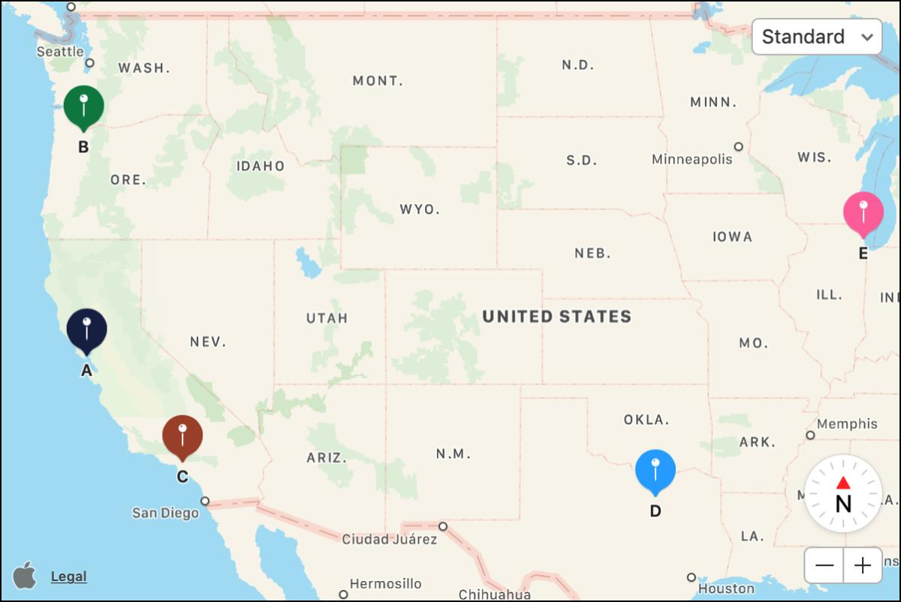

Maps have been part of .NET MAUI for quite some time, but some surprisingly common requirements have needed custom handlers or third-party libraries. With .NET 11, that's beginning to change.

A collection of improvements introduced in Preview 3 brings pin clustering, custom marker images, map styling, and new interaction events to the built-in `Map` control. There's also a new Azure Maps implementation for Windows, introduced in Preview 5.

Let's look at a couple of the additions, including how one of them works behind the scenes.

## Pin clustering without custom handlers

If you've worked with maps containing hundreds of locations, you'll be familiar with the problem. Zoom out far enough, and your map becomes a sea of overlapping pins. Clustering solves this by grouping nearby locations into a single marker, displaying the number of pins within that group.

In .NET MAUI 11, enabling clustering is as simple as setting a property:

```xml
<maps:Map
    IsClusteringEnabled="True"
    ClusterClicked="OnClusterClicked" />
```

That's it! Nearby pins are automatically grouped as the user zooms out, expanding into individual markers as they zoom back in.



*Image: [Apple developer docs](https://developer.apple.com/documentation/mapkitjs/clustering-annotations).*

You can also control which pins are grouped together using `ClusteringIdentifier`. For example, an application displaying holiday cottages and local attractions could keep each category in its own cluster.

```csharp
map.Pins.Add(new Pin
{
    Label = "Holiday Cottage",
    Location = new Location(50.12, -5.53),
    ClusteringIdentifier = "cottages"
});

map.Pins.Add(new Pin
{
    Label = "Local Attraction",
    Location = new Location(50.11, -5.54),
    ClusteringIdentifier = "attractions"
});
```

When a cluster is tapped, the `ClusterClicked` event provides access to its pins and location. By default, the map zooms towards the cluster, although you can override this behaviour by setting `e.Handled` to `true`.

## What's happening behind the scenes?

I was interested to see how Microsoft had approached the implementation, particularly given the differences between the native mapping APIs.

Looking at [PR #33831](https://github.com/dotnet/maui/pull/33831), contributed by Gerald Versluis, the implementation takes two different approaches.

On iOS and Mac Catalyst, clustering uses MapKit's native `MKClusterAnnotation` functionality. Apple handles the grouping and animation, allowing MAUI to take advantage of the existing platform implementation.

Android takes a different approach. The MAUI team implemented a grid-based clustering algorithm that recalculates groups as the zoom level changes, without introducing an additional dependency.

One small but interesting detail in the Android implementation is the check used to decide when clustering needs to be recalculated:

```csharp
// Recalculate clusters when zoom level changes significantly
var currentZoom = _googleMap.CameraPosition.Zoom;

if (Math.Abs(currentZoom - _lastClusterZoom) > 0.5f)
{
    // Recalculate clusters
}
```

*Excerpt adapted from the Android implementation in [dotnet/maui#33831](https://github.com/dotnet/maui/pull/33831).*

Rather than rebuilding the clusters for every small camera movement, the implementation checks whether the zoom level has changed enough to justify recalculation. It's a useful example of how the MAUI handlers can present a consistent API while taking different approaches on each platform.

## Custom pin images

Another welcome addition is the ability to assign an image directly to a pin.

Previously, replacing the platform's default marker often meant customising the native map handler. In .NET 11, the `Pin` class has an `ImageSource` property.

```csharp
var pin = new Pin
{
    Label = "Porthcurno Beach",
    Location = new Location(50.0436, -5.6544),
    ImageSource = ImageSource.FromFile("beach_pin.png")
};

map.Pins.Add(pin);
```

The API supports the usual MAUI image sources, including files, resources, streams and URIs. Images are scaled to the platform's default marker size, making it much easier to create recognisable markers without maintaining platform-specific rendering code.

## There's more!

Clustering and custom pins are probably the most immediately useful changes, but the Maps improvements go further.

You can now respond to long presses on the map, handle clicks on circles and polygons, control the visibility and drawing order of map elements, and animate map movements. Android also supports custom JSON map styles.

Windows deserves a mention, too. A new Azure Maps-backed implementation provides basic mapping functionality, although it doesn't yet support everything available on Android and iOS. In particular, pin clustering isn't currently supported on Windows.

These changes won't eliminate every reason to customise a map handler, but they make quite a few common scenarios considerably easier to implement. It's good to see the built-in Maps control getting some attention!

If you'd like to experiment with the new functionality, the team have published a [Maps sample application](https://github.com/dotnet/maui-samples/tree/main/11.0/UserInterface/Views/Map) demonstrating clustering, custom markers and other improvements.

## References and credits

- [What's new in .NET MAUI 11](https://learn.microsoft.com/en-us/dotnet/maui/whats-new/dotnet-11)
- [Maps documentation](https://learn.microsoft.com/en-us/dotnet/maui/user-interface/controls/map)
- [Pin clustering implementation — Gerald Versluis, PR #33831](https://github.com/dotnet/maui/pull/33831)
- [Official .NET MAUI Maps sample and screenshot — Microsoft](https://learn.microsoft.com/en-us/samples/dotnet/maui-samples/userinterface-map-features/)