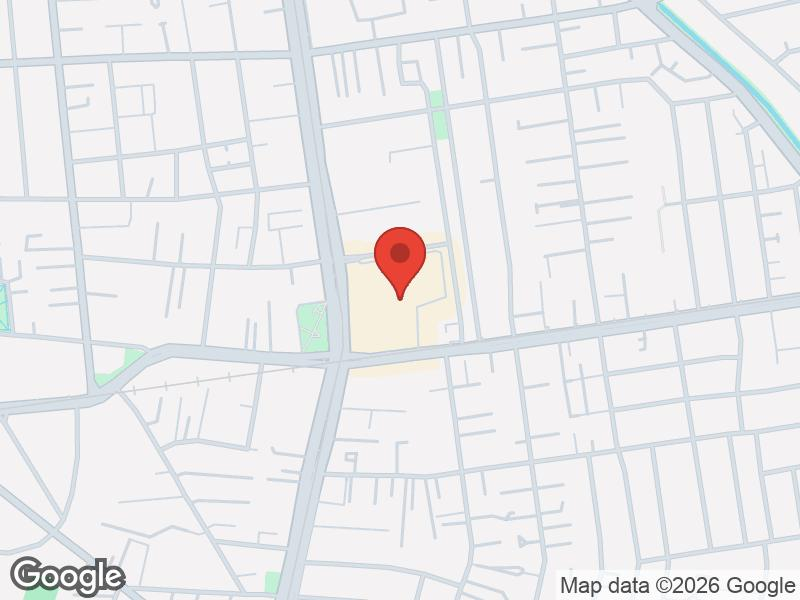
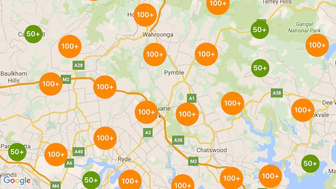
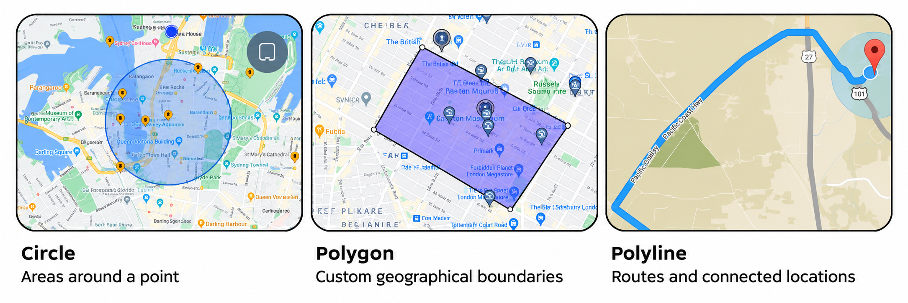

# Getting started with Maps in .NET MAUI 11

.NET MAUI 11 introduces one of the most substantial updates to the `Map` control since it was first introduced. We now have support for pin clustering, custom markers, interactive map elements, additional location events, and more control over how users interact with a map.

Previously, some of these features required custom handlers or platform-specific implementations. With .NET MAUI 11, much of that functionality is available directly through the cross-platform API.

In this tutorial, we'll build a simple map-based application, starting with the initial setup before exploring the new functionality. We'll use a collection of locations around Cornwall to demonstrate clustering, custom markers, interactive overlays and map navigation.

The majority of these improvements arrived in .NET 11 Preview 3, with Windows support following in Preview 5. All are included in the released .NET MAUI 11.

You can find the full list of improvements in the [.NET MAUI 11 release documentation](https://learn.microsoft.com/en-us/dotnet/maui/whats-new/dotnet-11?view=net-maui-11.0).

Get the accompanying [sample app on GitHub](https://github.com/tonyedwardspz/Maui-11-maps-demo).

## 1. Setting up the Map control

The `Map` control is available through the `Microsoft.Maui.Controls.Maps` NuGet package. It wraps the native mapping controls on each supported platform, giving us a familiar experience without needing to implement the underlying platform APIs ourselves.

Start by creating a .NET MAUI 11 application, then install the Maps package:

```bash
dotnet new maui -n MauiMapsDemo --framework net11.0
cd MauiMapsDemo
dotnet add package Microsoft.Maui.Controls.Maps
```

Next, register the Maps functionality in `MauiProgram.cs` using `UseMauiMaps()`.

```csharp
using Microsoft.Maui.Controls.Hosting;

namespace MauiMapsDemo;

public static class MauiProgram
{
    public static MauiApp CreateMauiApp()
    {
        var builder = MauiApp.CreateBuilder();

        builder
            .UseMauiApp<App>()
            .UseMauiMaps();

        return builder.Build();
    }
}
```

### Platform configuration

On Android, the map uses Google Maps, which requires a Google Maps API key. Add the following entries inside the `<application>` element of `Platforms/Android/AndroidManifest.xml`.

```xml
<meta-data
    android:name="com.google.android.geo.API_KEY"
    android:value="YOUR_GOOGLE_MAPS_API_KEY" />

<meta-data
    android:name="com.google.android.gms.version"
    android:value="@integer/google_play_services_version" />
```

The key must have access to the Maps SDK for Android. For production applications, restrict the key to the appropriate Android application ID and signing certificate, rather than using an unrestricted key.

On iOS and Mac Catalyst, no additional configuration is required simply to display a map. Permissions are only needed when accessing the user's location.

Windows is also supported in .NET MAUI 11, using Azure Maps. We'll cover the differences later, as not all of the new functionality is available on Windows.

## 2. Adding a map in XAML

One of the smaller, but particularly useful, changes in .NET MAUI 11 is the introduction of type converters for map coordinates and regions.

Previously, creating a `Location` or `MapSpan` in XAML could require verbose object declarations. We can now specify coordinates directly as strings, making the markup considerably easier to read.

Create a `MapsPage.xaml` file:

```xml
<ContentPage
    xmlns="http://schemas.microsoft.com/dotnet/2021/maui"
    xmlns:x="http://schemas.microsoft.com/winfx/2009/xaml"
    xmlns:maps="http://schemas.microsoft.com/dotnet/2021/maui/maps"
    x:Class="MauiMapsDemo.MapsPage"
    Title="Explore Cornwall">

    <maps:Map
        x:Name="ExploreMap"
        MapType="Street"
        Region="50.1188,-5.5376,0.15,0.15">

        <maps:Map.Pins>
            <maps:Pin
                Label="St Michael's Mount"
                Address="Marazion, Cornwall"
                Location="50.116,-5.478" />
        </maps:Map.Pins>

    </maps:Map>
</ContentPage>
```

And add the corresponding code-behind:

```csharp
namespace MauiMapsDemo;

public partial class MapsPage : ContentPage
{
    public MapsPage()
    {
        InitializeComponent();
    }
}
```

There are two improvements worth highlighting here.

The `Region` property is now bindable, allowing the visible map region to be declared in XAML or controlled through a binding. The value contains the latitude, longitude, latitude span and longitude span, respectively.

The `Location` property also supports the shorter coordinate syntax, so individual pins no longer need to construct a `Location` through `x:Arguments`.

These changes are particularly helpful for applications that use XAML extensively. You can see the implementation in [dotnet/maui#33995](https://github.com/dotnet/maui/pull/33995).

## 3. Adding pins with custom images



Pins have always been an important part of the MAUI Maps control, but customising their appearance previously involved working with native map APIs.

.NET MAUI 11 introduces `Pin.ImageSource`, allowing us to assign an image directly to a pin. This follows the same pattern used elsewhere in MAUI, so images can be supplied through the standard `ImageSource` infrastructure.

First, add a suitable image to `Resources/Images`, for example `attraction_pin.png`.

We can then create a pin programmatically:

```csharp
using Microsoft.Maui.Controls.Maps;
using Microsoft.Maui.Maps;

var pin = new Pin
{
    Label = "St Michael's Mount",
    Address = "Marazion, Cornwall",
    Location = new Location(50.116, -5.478),
    ImageSource = ImageSource.FromFile("attraction_pin.png")
};

ExploreMap.Pins.Add(pin);
```

The map will use our image instead of the platform's default marker.

We can also configure the image directly in XAML:

```xml
<maps:Pin
    Label="St Michael's Mount"
    Location="50.116,-5.478"
    ImageSource="attraction_pin.png" />
```

This gives us a straightforward way to distinguish different categories of locations. An application showing accommodation, attractions and restaurants, for example, could use a separate marker image for each category.

The implementation supports the standard MAUI `ImageSource` types, including file, URI, resource and stream sources. Images are scaled to the platform's default marker dimensions.

When providing custom images, consider how they appear at different device densities and zoom levels. A relatively simple icon with a clear silhouette will generally work better than a detailed image, particularly when the map contains a large number of pins.

## 4. Enabling pin clustering



*Image: [Google developer docs](https://developers.google.com/maps/documentation/ios-sdk/utility/marker-clustering).*

Clustering is probably the most immediately useful addition for applications displaying a large collection of locations.

When several pins are close together, the map can group them into a single cluster marker. As the user zooms in, those clusters are separated into smaller groups or individual pins.

Previously, implementing clustering often meant adding platform-specific code or integrating native clustering libraries. In .NET MAUI 11, enabling it is as simple as setting a property.

```xml
<maps:Map
    x:Name="ExploreMap"
    IsClusteringEnabled="True"
    ClusterClicked="OnClusterClicked"
    Region="50.1188,-5.5376,0.15,0.15" />
```

We can add several pins as normal:

```csharp
var locations = new[]
{
    ("St Michael's Mount", 50.116, -5.478),
    ("Land's End", 50.066, -5.715),
    ("Minack Theatre", 50.041, -5.651),
    ("Porthcurno Beach", 50.043, -5.655),
    ("St Ives", 50.211, -5.480)
};

foreach (var (name, latitude, longitude) in locations)
{
    ExploreMap.Pins.Add(new Pin
    {
        Label = name,
        Location = new Location(latitude, longitude),
        ClusteringIdentifier = "attractions"
    });
}
```

Notice the `ClusteringIdentifier` property. This allows pins to be assigned to different clustering groups, rather than treating every marker as part of the same collection.

For example, we might use `"attractions"` for visitor attractions and `"accommodation"` for properties. Pins with different clustering identifiers are kept in separate clustering groups.

### Handling cluster interactions

The new `ClusterClicked` event gives us an opportunity to respond when a user selects a cluster. This is useful when we want to display additional information or customise the normal zoom behaviour.

```csharp
private void OnClusterClicked(
    object sender,
    ClusterClickedEventArgs e)
{
    System.Diagnostics.Debug.WriteLine(
        $"Selected cluster contains {e.Pins.Count} pins");

    // The default behaviour is to zoom into the cluster.
    // Set Handled to true to prevent that behaviour.
    // e.Handled = true;
}
```

The event arguments expose the pins contained within the cluster, the cluster's geographical location and a `Handled` property.

By default, tapping a cluster zooms further into the map. Setting `Handled` to `true` prevents that behaviour, allowing us to implement our own interaction instead.

For a property-search application, this opens up some interesting possibilities. We could display the number of available properties in a particular area, provide a summary of the clustered results, or move to a more detailed map region.

The important distinction is that clustering now belongs to the map control itself. We no longer need to build a separate clustering implementation for each mobile platform.

Clustering is supported on Android, iOS and Mac Catalyst.

### Customising cluster markers
By default, cluster markers display the number of grouped pins using the platform's standard appearance. .NET MAUI 11 also introduces ClusterImageSource and ClusterImageProvider, giving us more control over how those markers look.

For example, we can provide a custom image to use for all clusters:

```xml
<maps:Map
    IsClusteringEnabled="True"
    ClusterImageSource="attraction_cluster.png" />
```

For more advanced scenarios, ClusterImageProvider accepts a callback that can return a different image based on the cluster's information, including its pin count, clustering identifier and location.

The provider takes precedence over ClusterImageSource. If it returns null, the map falls back to the static cluster image, or the default marker if one hasn't been configured.

This gives us a way to distinguish clusters representing different types of locations without changing how the individual pins are managed.

## 5. Responding to long presses on the map

.NET MAUI 11 also introduces the `MapLongClicked` event, which is raised when the user presses and holds a location on the map.

This is useful for scenarios where users need to select a location themselves, rather than choosing from a predefined set of pins. For example, we could allow someone to drop a marker for a meeting point, select a property location or mark somewhere they want to visit.

Add the event to our map:

```xml
<maps:Map
    x:Name="ExploreMap"
    MapLongClicked="OnMapLongClicked" />
```

Then handle it in the code-behind:

```csharp
private void OnMapLongClicked(
    object sender,
    MapClickedEventArgs e)
{
    ExploreMap.Pins.Add(new Pin
    {
        Label = "My location",
        Location = e.Location,
        Type = PinType.Place
    });
}
```

The event uses `MapClickedEventArgs`, giving us the geographical coordinates of the point that was pressed.

Notice that this isn't the same as attaching a `LongPressGestureRecognizer` to the `Map` control. The map event understands geographical coordinates, whereas a general-purpose gesture recogniser doesn't provide that information.

The regular `MapClicked` event remains available for handling single taps.

## 6. Drawing interactive shapes on a map



The Maps control already supports three types of geographical overlays: circles, polygons and polylines.

In .NET MAUI 11, these overlays become more useful with additional interaction events and properties for controlling their visibility and draw order.

### Creating a circle

Let's draw a circle around St Michael's Mount to represent an area of interest.

```csharp
using Microsoft.Maui.Controls.Maps;
using Microsoft.Maui.Maps;

var circle = new Circle
{
    Center = new Location(50.116, -5.478),
    Radius = Distance.FromKilometers(2),
    StrokeColor = Colors.Blue,
    StrokeWidth = 3,
    FillColor = Color.FromArgb("#403B82F6"),
    ZIndex = 1
};

ExploreMap.MapElements.Add(circle);
```

The `Radius` property uses the existing `Distance` type, allowing us to define the circle using kilometres, metres or miles.

### Creating a polygon

Polygons are useful for representing geographical boundaries, such as a search area, a conservation zone or a property boundary.

Unlike circles, a polygon is defined using a collection of coordinates.

```csharp
var polygon = new Polygon
{
    StrokeColor = Colors.Orange,
    StrokeWidth = 3,
    FillColor = Color.FromArgb("#40FF9800"),
    ZIndex = 2
};

polygon.Geopath.Add(new Location(50.120, -5.490));
polygon.Geopath.Add(new Location(50.125, -5.470));
polygon.Geopath.Add(new Location(50.110, -5.455));
polygon.Geopath.Add(new Location(50.105, -5.480));

ExploreMap.MapElements.Add(polygon);
```

The `Geopath` collection defines the vertices of the polygon. The map uses these points to draw the boundary and fill the enclosed area.

### Creating a polyline

We can also draw a line connecting several locations. This might represent a walking route, a section of coastline or a path through several attractions.

```csharp
var route = new Polyline
{
    StrokeColor = Colors.Purple,
    StrokeWidth = 5,
    ZIndex = 3
};

route.Geopath.Add(new Location(50.116, -5.478));
route.Geopath.Add(new Location(50.100, -5.520));
route.Geopath.Add(new Location(50.066, -5.715));

ExploreMap.MapElements.Add(route);
```

The example connects the points directly. If you need a route that follows roads or walking paths, you'll still need a routing service to provide the appropriate geometry.

### Handling overlay clicks

Previously, these elements were largely visual. In .NET MAUI 11, users can interact with them through click events.

Each overlay type exposes its own event: `CircleClicked`, `PolygonClicked` and `PolylineClicked`. These allow us to respond when a user selects a geographical element, rather than treating it as a purely visual part of the map.

We can subscribe each element to a shared event handler:

```csharp
circle.CircleClicked += OnMapElementClicked;
polygon.PolygonClicked += OnMapElementClicked;
route.PolylineClicked += OnMapElementClicked;

private void OnMapElementClicked(object? sender, EventArgs e)
{
    var elementType = sender switch
    {
        Circle => "Circle",
        Polygon => "Polygon",
        Polyline => "Polyline",
        _ => "Map element"
    };

    System.Diagnostics.Debug.WriteLine(
        $"Selected map element: {elementType}");
}
```

Notice that we're subscribing directly to the individual map elements, rather than to an event on the `Map` control itself. Each event provides the selected element as the sender, allowing us to use a single handler for all three types.

We can now use an overlay as an interactive geographical element rather than just a decoration. Selecting a search area could update a list of properties, while tapping a route could display information about the walk.

### Controlling visibility and layering

Another welcome improvement is the introduction of `IsVisible` and `ZIndex` on `MapElement`.

These let us show and hide map overlays without removing them from the `MapElements` collection, and control the order in which overlapping elements are drawn.

```csharp
// Hide the polygon without removing it.
polygon.IsVisible = false;

// Show it again.
polygon.IsVisible = true;

// Draw the polygon above lower-indexed overlays.
polygon.ZIndex = 10;
```

For applications with multiple map layers, this is particularly useful. We can provide controls that toggle walking routes, search boundaries or geographical regions without repeatedly destroying and recreating the underlying map elements.

The implementation is covered in [dotnet/maui#33993](https://github.com/dotnet/maui/pull/33993), while the overlay interactions were added through [dotnet/maui#29101](https://github.com/dotnet/maui/pull/29101).

## 7. Programmatically opening pin information windows

A pin can display an information window when it is selected. This normally contains the pin's label and address, with the presentation handled by the native map control.

.NET MAUI 11 adds `ShowInfoWindow()` and `HideInfoWindow()` methods to the `Pin` class, giving us control over when that information is displayed.

```csharp
var pin = new Pin
{
    Label = "Minack Theatre",
    Address = "Porthcurno, Cornwall",
    Location = new Location(50.041, -5.651)
};

ExploreMap.Pins.Add(pin);

// Show the information window.
pin.ShowInfoWindow();

// Hide the information window.
pin.HideInfoWindow();
```

The pin must first be added to the map before either method is called.

This is useful when selection takes place outside the map. For example, an application could display a collection of attractions underneath the map. Selecting an attraction from the collection could move the map to the corresponding marker and open its information window.

The new methods allow the map and the surrounding UI to work together more naturally, without the user needing to tap the same location twice.

## 8. Moving and zooming the map

The existing `MoveToRegion()` method lets us change the visible area of the map programmatically. In .NET MAUI 11, a new overload adds explicit control over animation.

We can move to a particular location and choose whether the transition should be animated:

```csharp
var destination = new Location(50.041, -5.651);

var region = MapSpan.FromCenterAndRadius(
    destination,
    Distance.FromKilometers(3));

ExploreMap.MoveToRegion(region, animated: true);
```

Setting `animated` to `true` creates a smoother transition between map regions, rather than immediately jumping to the new location.

This is especially useful when selecting locations from another part of the UI, as the movement helps communicate where the selected location is in relation to the previous view.

### Automatically fitting multiple locations

Another new addition is `MapSpan.FromLocations()`.

Previously, if we wanted to display every pin on a map, we might need to calculate the geographical bounds ourselves. This typically involved finding the minimum and maximum latitudes and longitudes, calculating a centre point and adding padding.

We can now let the framework do that work.

```csharp
var locations = ExploreMap.Pins
    .Select(pin => pin.Location)
    .ToList();

if (locations.Count > 0)
{
    var region = MapSpan.FromLocations(locations);

    ExploreMap.MoveToRegion(
        region,
        animated: true);
}
```

The resulting `MapSpan` encompasses the supplied locations with appropriate padding. The implementation also handles geographical edge cases such as locations crossing the antimeridian.

It's a relatively small API addition, but one that removes a surprising amount of repetitive code. A property-search app could use it after loading search results, ensuring that the map displays all the relevant properties rather than using a fixed starting location.

## 9. Applying custom map styles on Android

The default map appearance is generally suitable for most applications, but there are scenarios where a different style would work better. A dark theme might benefit from a matching map, for example, while a property-search application might want to reduce visual clutter by hiding some points of interest.

.NET MAUI 11 introduces the `MapStyle` property, allowing an Android map to use a custom Google Maps JSON style.

Create a file containing the style definition. The following example hides points of interest and applies a darker appearance.

```json
[
  {
    "featureType": "poi",
    "stylers": [
      { "visibility": "off" }
    ]
  },
  {
    "elementType": "geometry",
    "stylers": [
      { "color": "#242f3e" }
    ]
  },
  {
    "elementType": "labels.text.fill",
    "stylers": [
      { "color": "#746855" }
    ]
  },
  {
    "elementType": "labels.text.stroke",
    "stylers": [
      { "color": "#242f3e" }
    ]
  }
]
```

Save this as `map_style.json` in `Resources/Raw`, with its build action set to `MauiAsset`.

We can then load the JSON and assign it to the `MapStyle` property:

```csharp
#if ANDROID
using var stream = await FileSystem.OpenAppPackageFileAsync(
    "map_style.json");

using var reader = new StreamReader(stream);

ExploreMap.MapStyle = await reader.ReadToEndAsync();
#endif
```

It's important to understand that custom JSON styling is currently an Android-specific feature. The `MapStyle` property is part of the cross-platform API, but assigning a JSON style has no effect on iOS, Mac Catalyst or Windows.

The style can also be changed at runtime, allowing the application to respond to theme changes or user preferences. Setting `MapStyle` back to `null` restores the default appearance.

## 10. Tracking the user's location

The `Map` control already provides `IsShowingUser`, which displays the user's current location on the map, provided the required permissions have been granted.

.NET MAUI 11 extends this with two useful additions: the `UserLocationChanged` event and `LastUserLocation` property.

These allow us to respond when the user's location changes and retrieve the most recently reported location without making a separate geolocation request.

### Configuring permissions

Before using either feature, we need to configure location permissions.

On Android, add the following permissions to `Platforms/Android/AndroidManifest.xml`:

```xml
<uses-permission
    android:name="android.permission.ACCESS_FINE_LOCATION" />

<uses-permission
    android:name="android.permission.ACCESS_COARSE_LOCATION" />
```

On iOS, add a description of why location access is needed in `Platforms/iOS/Info.plist`:

```xml
<key>NSLocationWhenInUseUsageDescription</key>
<string>
    Your location is used to show nearby attractions.
</string>
```

The application must also request permission at runtime. This should happen in response to an appropriate user action, rather than assuming that permission is already available.

### Displaying the user's location

Once permission is granted, we can enable the location indicator on our map.

```csharp
var permission = await Permissions.RequestAsync<
    Permissions.LocationWhenInUse>();

if (permission == PermissionStatus.Granted)
{
    ExploreMap.IsShowingUser = true;
}
```

This displays the platform's standard user-location indicator.

It's worth remembering that `IsShowingUser` doesn't automatically move the map to the user's current position. It controls whether their location is displayed, while map navigation remains separate.

### Responding to location changes

With .NET MAUI 11, we can now subscribe to `UserLocationChanged` to receive updates whenever the map reports a new user location.

For example, we might want to update a label showing the user's coordinates:

```csharp
ExploreMap.UserLocationChanged += (sender, e) =>
{
    var location = e.Location;

    System.Diagnostics.Debug.WriteLine(
        $"User location: {location.Latitude}, {location.Longitude}");
};
```

The event uses `UserLocationChangedEventArgs`, which exposes a `Location` property containing the updated coordinates.

Let's extend this slightly and use the information to update our interface.

Add a label to the page, positioned underneath the map:

```xml
<Grid RowDefinitions="*,Auto">

    <maps:Map
        x:Name="ExploreMap"
        Grid.Row="0"
        Region="50.1188,-5.5376,0.15,0.15"
        IsClusteringEnabled="True" />

    <Label
        x:Name="LocationLabel"
        Grid.Row="1"
        Padding="16"
        Text="Waiting for location..."
        HorizontalTextAlignment="Center" />

</Grid>
```

We can then update the label from our event handler:

```csharp
private void OnUserLocationChanged(
    object sender,
    UserLocationChangedEventArgs e)
{
    var location = e.Location;

    LocationLabel.Text =
        $"Latitude: {location.Latitude:F5}, " +
        $"Longitude: {location.Longitude:F5}";
}
```

Register the handler in the page constructor, after `InitializeComponent()`:

```csharp
public MapsPage()
{
    InitializeComponent();

    ExploreMap.UserLocationChanged +=
        OnUserLocationChanged;
}
```

The event starts providing updates once location access has been granted, `IsShowingUser` is enabled and the platform has location information available.

### Accessing the last known location

The second addition is `LastUserLocation`, a property that returns the most recently reported user location.

```csharp
Location? location = ExploreMap.LastUserLocation;

if (location is not null)
{
    System.Diagnostics.Debug.WriteLine(
        $"Last location: {location.Latitude}, {location.Longitude}");
}
```

The property can return `null`, particularly when the map has only just been displayed or the device hasn't yet reported a location.

This is useful when another part of the application needs the location already known to the map. For example, a button could move the map to the user's current position.

```csharp
private void CentreOnUser()
{
    var location = ExploreMap.LastUserLocation;

    if (location is null)
        return;

    var region = MapSpan.FromCenterAndRadius(
        location,
        Distance.FromKilometers(2));

    ExploreMap.MoveToRegion(
        region,
        animated: true);
}
```

This gives us a relatively simple way to implement a "Find me" button without repeatedly calling the Geolocation API.

### When should we use Geolocation instead?

These new APIs are useful when location tracking is part of an existing map experience. However, they aren't intended to replace the broader MAUI Geolocation API.

If your application needs location information while the map isn't displayed, or needs to control location requests independently, `Geolocation` may still be a better fit.

For applications that use the map as their primary location interface, `UserLocationChanged` and `LastUserLocation` remove some of the additional plumbing previously needed to keep the map and application state synchronised.

As with any location functionality, it's important to handle permissions appropriately and avoid tracking the user's location when it isn't needed.

## 11. Using Maps on Windows

One of the later additions to .NET MAUI 11 was a Windows implementation of the `Map` control, introduced in Preview 5.

Unlike Android and iOS, which use Google Maps and Apple Maps respectively, the Windows implementation uses the WinUI 3 `MapControl`, backed by Azure Maps.

To enable it, create an Azure Maps account and configure your subscription key in `MauiProgram.cs`.

```csharp
builder
    .UseMauiApp<App>()
    .UseMauiMaps();

#if WINDOWS
builder.ConfigureEssentials(essentials =>
{
    essentials.UseMapServiceToken(
        "YOUR_AZURE_MAPS_SUBSCRIPTION_KEY");
});
#endif
```

The UseMapServiceToken() extension method is only available on Windows, so we use #if WINDOWS to ensure the configuration compiles correctly when targeting Android, iOS and Mac Catalyst.

The Windows implementation supports standard pins, moving and zooming the map, traffic information, and street, satellite and hybrid map types.

However, some functionality available on mobile platforms isn't supported, including geographical overlays, user-location display and pin information windows. The MapClicked event also doesn't fire when the user taps the map background on Windows. Pin clustering and custom pin-image behaviour should not be assumed to have parity with the mobile implementations.

These platform limitations are worth considering before building a map-heavy feature around the new APIs. Although the API is shared, it doesn't necessarily mean that every native map implementation has identical capabilities.

The Windows implementation is described in [dotnet/maui#34138](https://github.com/dotnet/maui/pull/34138).

## 12. Using Maps with MVVM

So far, we've used code-behind to demonstrate the new functionality, which keeps the examples relatively small. For a larger application, we'll generally want to manage our collection of locations through a view model instead.

The `Map` control already supports `ItemsSource` and `ItemTemplate`, allowing us to bind a collection of locations in much the same way as we would with a `CollectionView`.

These APIs aren't new in .NET MAUI 11, but they work particularly well with the new clustering and custom marker functionality.

For example, suppose our view model exposes an `ObservableCollection<Attraction>`.

```csharp
public class Attraction
{
    public string Name { get; set; } = string.Empty;

    public Location Location { get; set; } = new(0, 0);
}
```

We can then bind our map to that collection:

```xml
<maps:Map
    ItemsSource="{Binding Attractions}"
    IsClusteringEnabled="True">

    <maps:Map.ItemTemplate>
        <DataTemplate>
            <maps:Pin
                Label="{Binding Name}"
                Location="{Binding Location}"
                ImageSource="attraction_pin.png"
                ClusteringIdentifier="attractions" />
        </DataTemplate>
    </maps:Map.ItemTemplate>

</maps:Map>
```

When the collection changes, the map can update its displayed pins without us manually adding and removing each one.

Combining this approach with clustering gives us a straightforward way to build data-driven map experiences. We can keep the locations and business logic in our view model, while the map handles marker rendering and clustering.

Map events can still be handled through code-behind or forwarded to the view model, depending on the architecture of the application.

## 13. Putting it together

With these additions, we can now create a reasonably capable map experience without writing any platform-specific map handlers.

For our Cornwall example, we could build a page with clustered markers for attractions, custom icons to distinguish different location types, and an option to select a location by pressing and holding the map. We could then use geographical overlays to display search boundaries, respond to selections, and move between results using animated camera transitions.

The new location events also make it easier to build functionality around the user's position, such as displaying nearby attractions or providing a button to return to their current location.

An important consideration is how much data we load onto the map at once. Clustering improves the presentation of overlapping markers, but it doesn't replace efficient data loading. For applications displaying thousands of properties or points of interest, it's still worth filtering results and updating the map as the user navigates.

## What's changed in .NET MAUI 11?

For reference, here's a summary of the new Maps functionality covered in this tutorial.

| API or feature | Purpose |
|---|---|
| `Map.Region` | Bindable map region and simpler XAML configuration |
| `Location` / `MapSpan` converters | Direct coordinate and region values in XAML |
| `IsClusteringEnabled` | Automatically group nearby pins |
| `Pin.ClusteringIdentifier` | Separate clustering groups |
| `ClusterClicked` | Respond to selections of clustered markers |
| `Pin.ImageSource` | Display custom marker images |
| `MapLongClicked` | Respond to long presses at geographical coordinates |
| `MapElementClick` | Handle taps on geographical overlays |
| `IsVisible` / `ZIndex` | Control map overlay visibility and drawing order |
| `ShowInfoWindow()` / `HideInfoWindow()` | Control pin information windows programmatically |
| `MoveToRegion(span, animated)` | Animate transitions between map regions |
| `MapSpan.FromLocations()` | Calculate a map region containing multiple locations |
| `MapStyle` | Apply Google Maps JSON styling on Android |
| `UserLocationChanged` | Receive updates when the user's location changes |
| `LastUserLocation` | Access the most recently reported user location |
| `ClusterImageSource` | Set a custom image for cluster markers |
| `ClusterImageProvider` | Generate cluster-marker images based on cluster information |
| Windows Map support | Display maps using Azure Maps |

## Looking at the implementation

A particularly interesting aspect of these improvements is that the team has extended the existing Maps API rather than introducing a replacement control.

The changes are largely additive. Existing `Map`, `Pin` and `MapElement` types remain central to the implementation, with new bindable properties, events and methods exposing functionality that previously required custom platform integrations.

That approach is useful for existing applications. We can introduce clustering, custom markers or additional interactions incrementally rather than replacing the map architecture.

It also reflects one of the broader themes in .NET MAUI 11: improving the capabilities and consistency of the existing controls while reducing the amount of platform-specific code applications need to maintain.

For anyone who has previously written custom map handlers to support clustering or marker images, these additions are worth investigating. There may now be opportunities to remove that code and rely on the functionality provided by the framework.

## Get the sample

Head over to [GitHub to browse the matching sample](https://github.com/tonyedwardspz/Maui-11-maps-demo). Each of the sections has it's own view, meaning you can follow along with the tutorial.

## Further reading

The following resources cover the new APIs and their implementation:

- [.NET MAUI Map control documentation](https://learn.microsoft.com/en-us/dotnet/maui/user-interface/controls/map?view=net-maui-11.0)
- [What's new in .NET MAUI 11](https://learn.microsoft.com/en-us/dotnet/maui/whats-new/dotnet-11?view=net-maui-11.0)
- [Official .NET MAUI 11 Maps sample](https://learn.microsoft.com/en-us/samples/dotnet/maui-samples/userinterface-map-features/)
- [Map coordinate converters and XAML improvements — #33995](https://github.com/dotnet/maui/pull/33995)
- [Map element visibility and ZIndex — #33993](https://github.com/dotnet/maui/pull/33993)
- [Map element interactions — #29101](https://github.com/dotnet/maui/pull/29101)
- [Windows Maps implementation — #34138](https://github.com/dotnet/maui/pull/34138)

The official Maps sample is particularly useful if you want to explore the new functionality in a working application. It demonstrates several of the features discussed here, including clustering, custom pins, long-press interactions and overlays.

With .NET MAUI 11, the `Map` control has become significantly more useful for applications that need more than a simple collection of markers. There's still room for additional functionality and better parity between platforms, but this release removes several of the reasons developers previously needed to implement custom native map behaviour.
